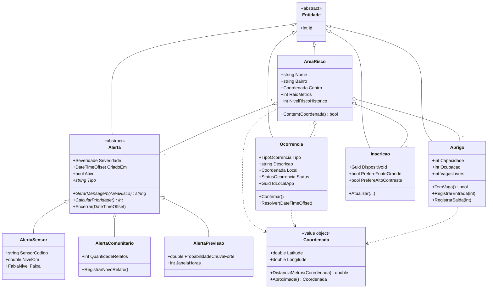
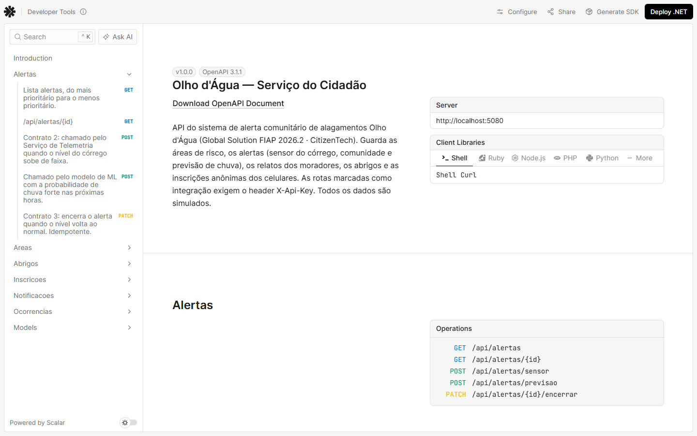
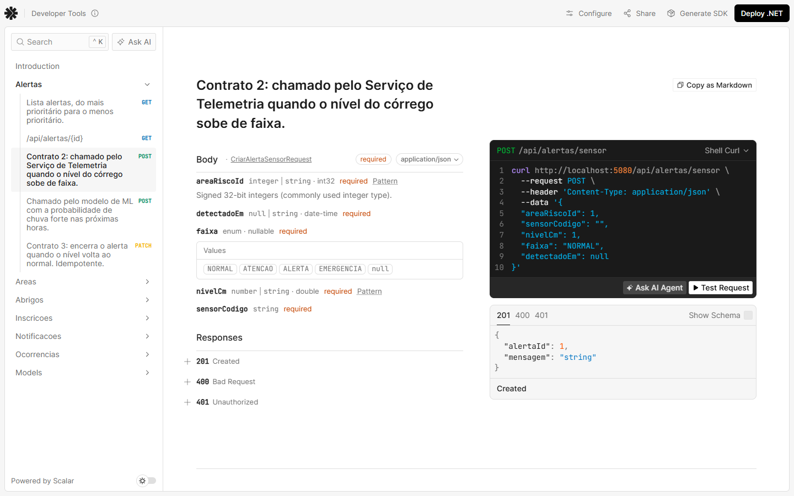
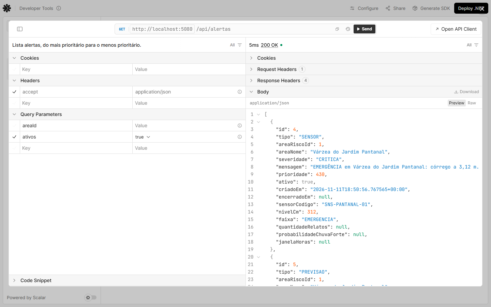
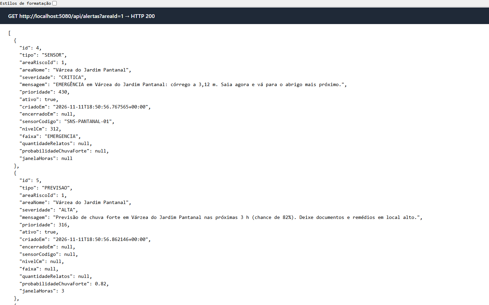
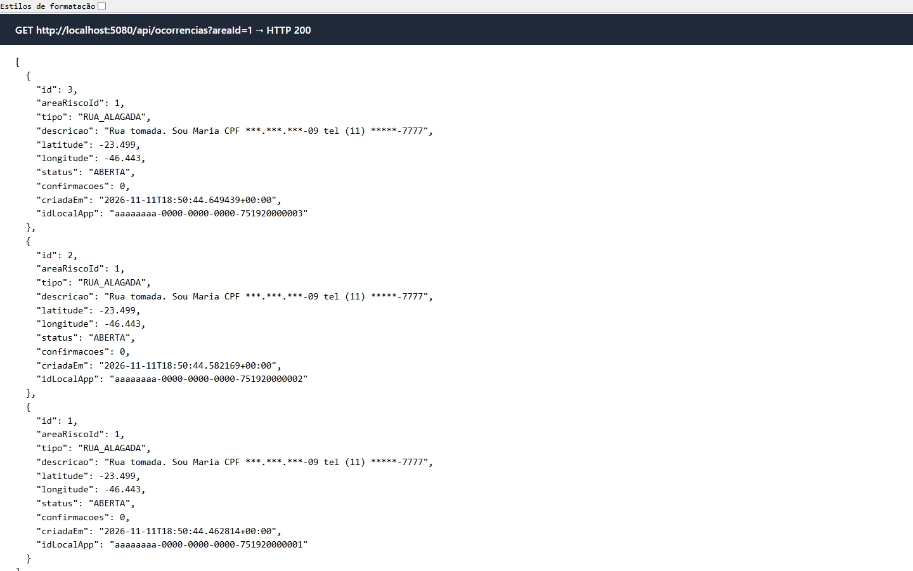
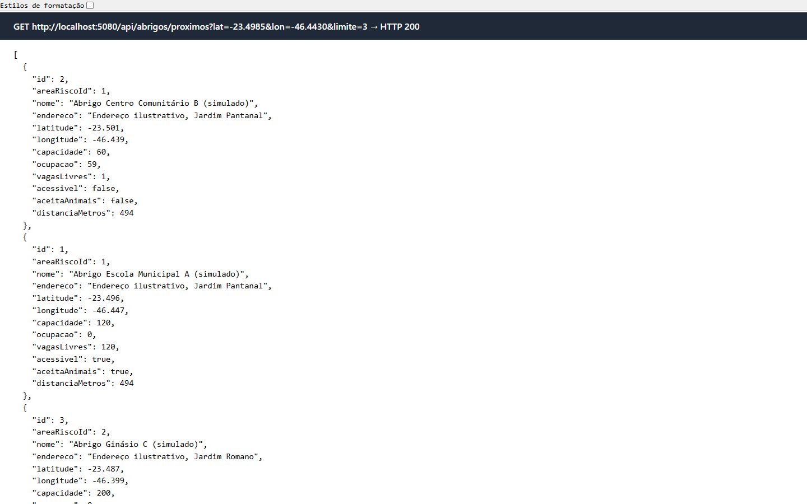
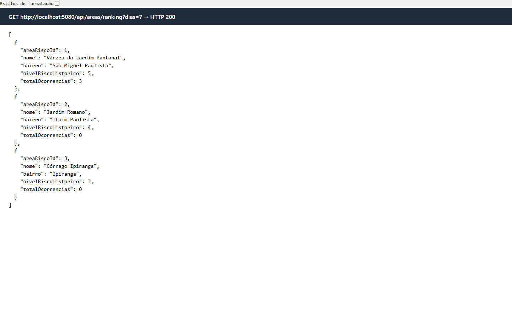

# Serviço do Cidadão — Olho d'Água (C# / .NET 10)

Web API da CitizenTech **Olho d'Água**, um sistema de alerta comunitário de alagamentos. Este serviço cuida de tudo o que chega ao morador:

- as **áreas de risco** monitoradas
- os **alertas**, que vêm do sensor do córrego, da própria comunidade ou da previsão de chuva do modelo de ML
- os **relatos** de alagamento feitos pelo app
- os **abrigos** com vaga
- as **inscrições** anônimas dos celulares

Dois outros sistemas usam esta API: o **app Expo** consulta e envia dados, e o **Serviço de Telemetria** (Java, repositório de SOA) cria e encerra os alertas de sensor.

> A Ficha da CitizenTech está no [README da raiz](../README.md), e o plano completo está no [PLANO.md](../PLANO.md).

## Tecnologias

| | |
|---|---|
| Plataforma | .NET 10 · ASP.NET Core Web API (controllers) |
| Banco | PostgreSQL 16 (Docker) · Entity Framework Core 10 + Npgsql · migrations |
| Documentação | OpenAPI nativo do .NET + **Scalar**, em `http://localhost:5080/scalar` |
| Testes | xUnit · EF Core InMemory · FakeTimeProvider (**47 testes**) |

## Como rodar

**Pré-requisitos:** .NET SDK 10, Docker Desktop aberto e a ferramenta do EF (`dotnet tool install --global dotnet-ef`).

1. Na raiz do repositório, suba o banco. Ele cria os bancos `cidadao` e `telemetria`.
   ```bash
   docker compose -f infra/docker-compose.yml up -d
   ```
2. Entre na pasta do serviço:
   ```bash
   cd servico-cidadao-dotnet
   ```
3. Rode a API. Em Development ela aplica as migrations e cria os dados de demonstração sozinha.
   ```bash
   dotnet run --project src/OlhoDagua.Cidadao.Api
   ```
4. Abra a documentação interativa em http://localhost:5080/scalar.

**Outros comandos:**
- Rodar os testes:
  ```bash
  dotnet test
  ```
- Rodar o roteiro ponta a ponta, com a API no ar:
  ```bash
  bash scripts/teste-ponta-a-ponta.sh
  ```
- Para o celular acessar a API pela rede (o app usa o IP da máquina), suba com o perfil `lan`:
  ```bash
  dotnet run --project src/OlhoDagua.Cidadao.Api --launch-profile lan
  ```
- Aplicar as migrations manualmente, sem subir a API:
  ```bash
  dotnet ef database update -p src/OlhoDagua.Cidadao.Infrastructure -s src/OlhoDagua.Cidadao.Api
  ```

**Configuração** (`appsettings.Development.json`):

| Chave | Valor em desenvolvimento |
|---|---|
| `ConnectionStrings:Default` | `Host=localhost;Port=5432;Database=cidadao;Username=olho;Password=olho123` |
| `Integracao:ApiKey` | `olhodagua-dev-chave`: header `X-Api-Key` exigido nas rotas usadas pela Telemetria e pelo ML |
| `Notificacao:Tipo` | `PushSimulado` (padrão) ou `Console`: troca a implementação de `INotificador` pela DI |

Todos os dados são **simulados**: abrigos com nomes genéricos e coordenadas aproximadas. Nenhum dado pessoal real é usado.

## Arquitetura em camadas

```
src/
├── OlhoDagua.Cidadao.Domain/          entidades, value object, enums e regras de negócio (sem dependências)
├── OlhoDagua.Cidadao.Application/     interfaces, DTOs, serviços, regra do alerta comunitário, sanitizador de PII
├── OlhoDagua.Cidadao.Infrastructure/  EF Core (DbContext, configurações, migrations, seed), repositórios, notificadores
└── OlhoDagua.Cidadao.Api/             controllers, filtro de API key, tratamento de erros (ProblemDetails), Program.cs
tests/
└── OlhoDagua.Cidadao.Tests/           testes de domínio e de aplicação
```

As dependências apontam para dentro: **Api → Application → Domain**, e a **Infrastructure** implementa as interfaces da Application.

## Diagrama de classes do domínio



## Endpoints

| Método | Rota | Descrição |
|---|---|---|
| GET | `/api/areas` · `/api/areas/{id}` | Áreas de risco e o detalhe de cada uma (alertas ativos, relatos em aberto) |
| GET | `/api/areas/ranking?dias=7` | Áreas com mais relatos no período |
| GET | `/api/alertas?areaId=&ativos=true` | Alertas ordenados por prioridade, cada um com a sua mensagem |
| GET | `/api/alertas/{id}` | Detalhe de um alerta |
| POST | `/api/alertas/sensor` 🔑 | Contrato ②: chamado pela Telemetria quando o nível sobe de faixa |
| POST | `/api/alertas/previsao` 🔑 | Chamado pelo modelo de ML |
| PATCH | `/api/alertas/{id}/encerrar` 🔑 | Contrato ③: nível voltou ao normal (idempotente) |
| GET | `/api/ocorrencias?areaId=&status=` · `/api/ocorrencias/{id}` | Relatos (coordenada aproximada, sem PII) |
| POST | `/api/ocorrencias` | Novo relato. Idempotente por `idLocalApp` (201 novo, 200 reenvio) |
| POST | `/api/ocorrencias/{id}/confirmar` | Outro morador confirma o relato |
| PATCH | `/api/ocorrencias/{id}/resolver` | Marca o relato como resolvido |
| GET | `/api/abrigos?areaId=` · `/api/abrigos/{id}` | Abrigos |
| GET | `/api/abrigos/proximos?lat=&lon=&acessivel=&limite=5` | Abrigos com vaga, do mais próximo para o mais distante |
| POST | `/api/abrigos/{id}/entrada` · `/api/abrigos/{id}/saida` | Ocupação do abrigo (409 se não houver vaga) |
| POST | `/api/inscricoes` · GET `/api/inscricoes/{dispositivoId}` | Inscrição anônima do celular numa área |
| GET | `/api/notificacoes?dispositivoId=` | Histórico dos pushes simulados (para a demonstração) |

🔑 = exige o header `X-Api-Key`.

**Formatos:**
- Os enums trafegam em MAIÚSCULAS, por exemplo `"ALERTA"` e `"RUA_ALAGADA"`.
- Os erros seguem o padrão **ProblemDetails (RFC 7807)**:

| Status | Quando |
|---|---|
| 400 | validação ou regra de negócio |
| 401 | chave de integração ausente ou errada |
| 404 | recurso inexistente |
| 409 | conflito, por exemplo abrigo lotado |

Os exemplos prontos estão em [`OlhoDagua.Cidadao.http`](OlhoDagua.Cidadao.http).

## Onde cada critério da rubrica está no código

| Critério (peso) | Onde |
|---|---|
| **POO (3,0)** | **Herança e polimorfismo:** `Alerta` é abstrata, e as três subclasses (`AlertaSensor`, `AlertaComunitario`, `AlertaPrevisao`) implementam do seu jeito `GerarMensagem()` e `CalcularPrioridade()` (veja [`Domain/Entidades`](src/OlhoDagua.Cidadao.Domain/Entidades)). **Encapsulamento:** setters privados e estado alterado só por métodos que validam, como `Abrigo.RegistrarEntrada`, `Ocorrencia.Confirmar` e `Alerta.Encerrar`. **Value object** imutável: [`Coordenada`](src/OlhoDagua.Cidadao.Domain/ValueObjects/Coordenada.cs) (Haversine). **Hierarquia de exceções de domínio:** `DominioException` → `ConflitoDominioException` → `AbrigoSemVagaException`. **Pattern matching por tipo** em [`Mapeadores`](src/OlhoDagua.Cidadao.Application/Mapeamento/Mapeadores.cs). |
| **Web API (2,5)** | Controllers REST em [`Api/Controllers`](src/OlhoDagua.Cidadao.Api/Controllers) com os status codes corretos (201 + `Location`, 204, 400, 401, 404, 409), DTOs separados das entidades, validação com Data Annotations, filtro [`ExigeApiKey`](src/OlhoDagua.Cidadao.Api/Infra/ExigeApiKeyAttribute.cs), [`TratadorDeErros`](src/OlhoDagua.Cidadao.Api/Infra/TratadorDeErros.cs) gerando ProblemDetails, CORS e documentação no Scalar. |
| **EF Core + LINQ (1,5)** | [`CidadaoDbContext`](src/OlhoDagua.Cidadao.Infrastructure/Persistencia/CidadaoDbContext.cs) e [`Configuracoes`](src/OlhoDagua.Cidadao.Infrastructure/Persistencia/Configuracoes.cs): **TPH** para os alertas (coluna `TipoAlerta`), `Coordenada` como owned type, enums como texto, índice único e check constraint. Migration em [`Persistencia/Migrations`](src/OlhoDagua.Cidadao.Infrastructure/Persistencia/Migrations). **LINQ** em [`Repositorios`](src/OlhoDagua.Cidadao.Infrastructure/Repositorios/Repositorios.cs): ranking com subconsulta traduzida para SQL, `OfType<T>()` sobre o TPH, filtros compostos; e LINQ to Objects nos serviços (ordenação por prioridade polimórfica e abrigos por distância). |
| **Async/Await (1,0)** | Toda a cadeia é assíncrona (controller → serviço → repositório → EF Core) e repassa `CancellationToken`. O notificador push simula a latência com `await Task.Delay`. |
| **Qualidade do código (2,0)** | Camadas com dependências para dentro; **injeção de dependência** por interfaces (`IRepositorio<T>`, serviços, `INotificador` com 2 implementações trocáveis pela configuração, `TimeProvider`); **47 testes** xUnit; build sem avisos; nenhum pacote vulnerável; este README. |

## Regras de negócio que vale mostrar

- **Alerta comunitário:** 3 relatos não resolvidos na mesma área em 60 minutos geram um alerta. Um 4º relato **reforça** o alerta existente em vez de criar outro (veja [`RegraAlertaComunitario`](src/OlhoDagua.Cidadao.Application/Servicos/RegraAlertaComunitario.cs)).
- **Um alerta de sensor por vez:** quando o mesmo sensor sobe de faixa, o alerta anterior é encerrado.
- **Relato offline sem duplicar:** o app gera o `idLocalApp`. Se reenviar o relato depois de ficar sem internet, a API devolve o existente.
- **Privacidade:**
  - CPF, telefone e e-mail digitados na descrição são mascarados antes de salvar ([`SanitizadorPii`](src/OlhoDagua.Cidadao.Application/Pii/SanitizadorPii.cs)).
  - A localização pública do relato é arredondada para cerca de 110 m.
  - A inscrição do celular não guarda nome nem telefone.

## Evidências

- [`docs/evidencia-teste-ponta-a-ponta.txt`](docs/evidencia-teste-ponta-a-ponta.txt): saída real do roteiro ponta a ponta, com o banco zerado antes.
- [`docs/evidencia-testes-unitarios.txt`](docs/evidencia-testes-unitarios.txt): os 47 testes aprovados.
- [`docs/openapi.json`](docs/openapi.json): a especificação OpenAPI gerada pela API.
### Prints da API em execução

Os prints foram tirados com a API rodando contra o PostgreSQL, depois do roteiro ponta a ponta e de três alertas de demonstração (todos os dados são simulados).

**1. Documentação no Scalar:** título, descrição e grupos de endpoints.


**2. Contrato 2 (`POST /api/alertas/sensor`):** corpo com a `faixa` como texto, além das respostas 201, 400 e 401.


**3. Requisição executada pelo Scalar:** `GET /api/alertas` respondendo 200 OK. A EMERGÊNCIA do sensor aparece no topo, com prioridade 430.


**4. Alertas da área 1:** os três tipos (sensor, previsão e comunitário), ordenados por prioridade e com a mensagem gerada por cada subclasse.


**5. Relatos dos moradores:** CPF e telefone mascarados (`***.***.***-09`, `(11) *****-7777`) e localização arredondada.


**6. Abrigos mais próximos com vaga:** ordenados por distância. O abrigo B está com 59 de 60 vagas ocupadas.


**7. Ranking das áreas:** quantidade de relatos nos últimos 7 dias, calculada por LINQ traduzido para SQL.


## Integrantes

*a preencher*
